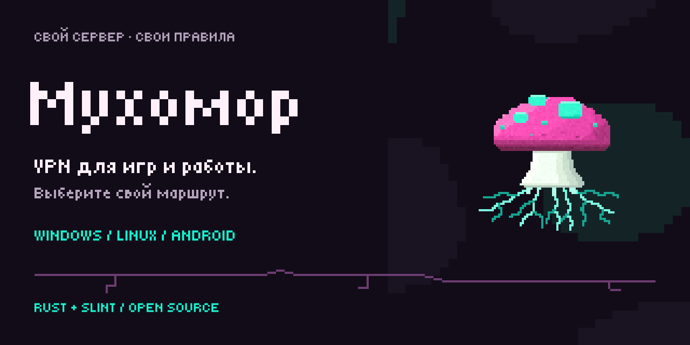
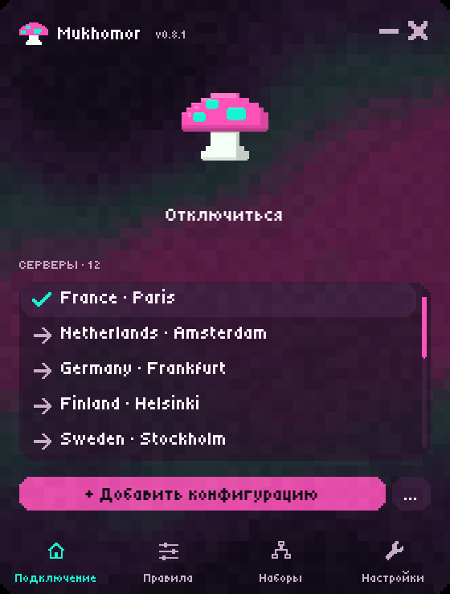
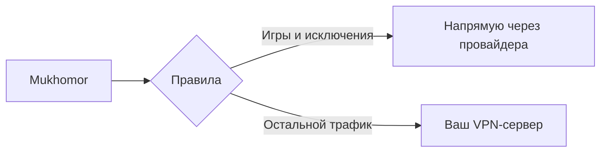
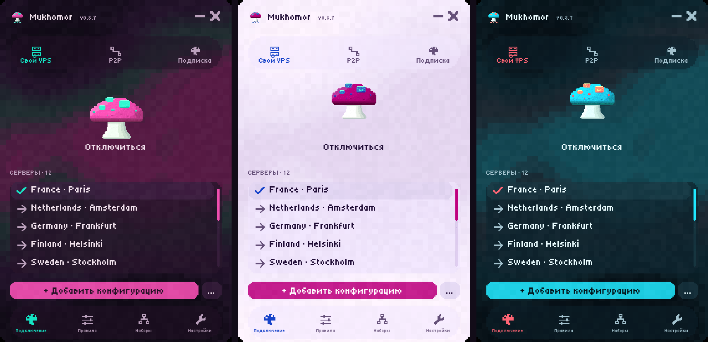

  

  
  
  
  
  
  
  

  <a href="https://github.com/0nionow1/Mukhomor/releases/tag/v0.8.2"><b>Скачать для Windows, Linux и Android</b></a> ·
  <a href="docs/README.md">Документация</a> ·
  <a href="docs/vps-and-vpn.md">Свой VPS и VPN</a> ·
  <a href="CHANGELOG.md">Что нового</a> ·
  <a href="ROADMAP.md">Roadmap</a> ·
  <a href="README.en.md">English</a>

# Mukhomor · Мухомор

**VPN для нужных сервисов. Прямое соединение для игр.**

Mukhomor — открытый клиент для Windows, Linux и Android для российских игроков, которым нужен VPN, но мешает лишний маршрут до игрового сервера. Добавьте свой VPN-профиль, а игры и выбранные сайты отправляйте напрямую.

В основе — [mihomo от MetaCubeX](https://github.com/MetaCubeX/mihomo/tree/v1.19.32). Mukhomor добавляет нативный интерфейс, локальный импорт серверов, готовые игровые исключения и управление установкой, подключением и восстановлением DNS. Сетевые протоколы реализует mihomo; это независимый проект.

## Что нового в 0.8.2

- **Обновление по кнопке.** В настройках появились проверка новой версии, загрузка с прогрессом и установка для Windows, Linux и Android.
- **Проверка пакета.** Клиент сверяет SHA-256, платформу и номер версии. Android проверяет подпись APK и открывает системный установщик.
- **Сохранение данных.** Профили, правила и оформление остаются на месте. Перед установкой нужно отключить VPN и сохранить изменения.

Пользователям Slint-версии **0.8.1** потребуется один раз установить полный пакет 0.8.2 вручную. После этого следующие выпуски устанавливаются через **Настройки → Проверить обновления → Обновить приложение**.

## Сохранено из 0.8.1

Версия **0.8.1**, общий интерфейс — **Slint**. Windows, Linux и Android входят в обязательные платформы проекта. Для новых платформ добавлены TUN/VpnService, локальный импорт, правила и отдельные сборщики. [Сборка, установка и проверка платформ](docs/platforms.md). Выбирайте файл своей платформы и учитывайте статус сборки в релизе.

После 0.7.2 приложение перешло на Slint и получило Linux и Android:

- **Общий интерфейс на Slint.** Пиксельный дизайн, анимированная заставка и фон, темы и редактор правил на трёх платформах.
- **Linux x64.** Установщик, TUN-контроллер, X11/Wayland, импорт и разделение трафика.
- **Android 8+.** APK для ARM64/x86_64, системный импорт документов, VpnService и фоновое подключение с уведомлением.
- **Новый сайт.** Единые пиксельные шрифты, розовые корни, интерактивные teal-акценты и каталог релизов.

Также сохранены возможности предыдущего выпуска:

- **20 тем и три размера интерфейса.** Неон по умолчанию, пиксельный мухомор и значки в цветах темы, анимированный фон.
- **Наборы для себя и друзей.** Отдельные страницы управления и редактирования, готовые шаблоны, импорт и экспорт JSON без серверных реквизитов.
- **Больше готовых исключений.** 286 игровых процессов, 1 123 игровых доменных правила и 17 торрент-клиентов; офлайн-списки и обновление источников.
- **Удобнее каждый день.** Независимый запуск с Windows, автоподключение последнего успешного сервера, меньше лишней работы при опросе статуса и сохранении настроек.

Полное описание, включая изменения Mycelium, защиту данных и границы экспериментального полного режима: [обновление 0.7.2 → 0.8.1](CHANGELOG.md#081--2026-10-16).

## Нативный интерфейс на Slint

Mukhomor использует Rust и Slint с программной отрисовкой, без браузерного движка. Сохранены пиксельная графика, темы и воздушная композиция. Интерфейс, контроллер и сетевое ядро работают отдельными компонентами; старые замеры памяти GDI-интерфейса к Slint не относятся. [Как проверять производительность](docs/performance.md).

## Что умеет

| Возможность | Для чего |
| --- | --- |
| Исключения по `.exe`, доменам, зонам и IP/CIDR | Игра — напрямую, остальной трафик — через VPN |
| Готовые правила | 286 игровых процессов, игровые платформы и CDN, 17 торрент-клиентов, российские сервисы, Steam и Ozon |
| Наборы правил | Создание, удаление, включение и обмен файлами в Наборах; редактирование шести списков на странице Правила |
| 21 стандартный тип и экспериментальный Mycelium | WireGuard/AmneziaWG, VLESS, VMess, Trojan, Shadowsocks, Hysteria 2 и [другие](docs/protocols.md); Mycelium требует отдельной сборки ядра |
| Локальный импорт | Файл, ссылка, список ссылок, ограниченные JSON/YAML и inline OpenVPN |
| Нативный Rust/Slint интерфейс | 20 тем, размеры 85/100/125%, пиксельная анимация, трей, Русский/English; без WebView |
| Подключение и восстановление | Отмена запуска, восстановление DNS, автоподключение, обновление с сохранением профилей |

Прямые исключения работают для TCP и UDP. Они убирают VPN из игрового маршрута, но не гарантируют пинг ниже вашего обычного соединения: результат зависит от провайдера и игрового сервера.

## Запуск за несколько минут

В **0.8.2** доступно **Настройки → Проверить обновления → Обновить приложение** для Windows, Linux и Android. Пакет проверяется по SHA-256, профили и настройки сохраняются. Перед установкой отключите VPN и сохраните изменения; система запросит необходимые разрешения (`pkexec` на Linux).

| Платформа | Файл и установка |
| --- | --- |
| Windows 10/11 x64 | ZIP: распакуйте целиком и запустите `Mukhomor/mukhomor.exe` |
| Linux x64 | tar.gz: распакуйте, выполните `sudo bash install.sh`, затем `mukhomor` от обычного пользователя |
| Android 8+ | APK для ARM64/x86_64: установите и выдайте системное разрешение VPN; APK подписан постоянным ключом проекта |

[Требования и ограничения платформ](docs/platforms.md). Шаги для Windows:

1. Скачайте **`Mukhomor-X.Y.Z-windows-x64.zip`** из [последнего релиза](https://github.com/0nionow1/Mukhomor/releases/tag/v0.8.2).
2. Распакуйте **весь архив** и запустите **`Mukhomor/mukhomor.exe`**. Подтвердите запрос Windows при первой установке.
3. Нажмите **Добавить конфигурацию** и выберите свой файл или вставьте серверную ссылку/текст.
4. Выберите сервер и нажмите **Подключиться**. При необходимости добавьте `.exe` игры на странице **Правила** и сохраните.

Нужны Windows 10/11 **x64** и собственный серверный профиль. Серверы, ключи и подписки не входят в комплект. EXE пока без подписи издателя; в Releases есть SHA256 для проверки архивов. Полное руководство: [установка, трей, обновление и удаление](docs/getting-started.md).

Крестик скрывает окно в трей и сохраняет VPN. **Выход из Mukhomor** в трее отключает VPN и восстанавливает DNS. Обновления доступны в настройках; для первоначального перехода с 0.8.1 распакуйте полный пакет 0.8.2 и запустите его EXE.

## Как разделяется трафик

В **Настройках** независимы **Запуск с Windows** и **Автоподключение VPN**. Первый запускает интерфейс в трее после входа в Windows; второй подключает последний успешно включённый сервер. Для обоих действий включите оба параметра. Автозапуск интерфейса по умолчанию выключен. Выбор другого сервера без подключения не меняет историю; удаление последнего подключённого сервера очищает её. Обновление сохраняет регистрацию автозапуска и учитывает отключение в настройках Windows.

Ручной **Выход из Mukhomor** сохраняет отключение до следующей загрузки Windows: повторный автозапуск в этой же загрузке открывает только интерфейс в трее. Обычный ручной запуск приложения позволяет подключиться снова.

На странице **Наборы** создавайте и удаляйте наборы, включайте их галочкой в списке, импортируйте и экспортируйте для передачи другу. **+ Готовый** добавляет копию стандартного набора. На странице **Правила** выберите набор и один из шести типов списков; **Добавить** и **Убрать** изменяют строки, а **Параметры** открывают описание и источники доменов. **Мои правила** хранятся отдельно. **Сохранить** применяет общий черновик всех наборов. Импорт создаёт отдельный выключенный набор; файл экспорта содержит только его правила и описание, без серверов и настроек подключения. Сохранённые параметры DNS продолжают использоваться контроллером; расширенные элементы Slint отслеживаются в [списке оставшихся задач](ui/README.md#remaining-work-and-qualification).

Общий размер настроек ограничен 2 МиБ в сериализованном виде. При превышении приложение сохраняет введённые данные в редакторе и предлагает сократить списки. Существующие настройки переносятся без восстановления ранее удалённых пользователем правил.

По умолчанию напрямую идут заданные игровые процессы и лаунчеры, торрент-клиенты, включённые списки игровых сервисов, России и Steam, российские доменные зоны и международные домены российских сервисов. Правила можно изменить. Прямой трафик использует обычный внешний IP вашего провайдера. Существующие установки получают расширенные базовые правила через восстановление выбранного пресета или сброс правил после обновления приложения. [Состав пресетов, примеры и приоритеты исключений](docs/gaming-and-routing.md).

Полный режим VPN и WFP-защита доступны как экспериментальные возможности. Реальная проверка блокировки утечек, восстановления службы и перезагрузки в Windows VM ещё не завершена. [Поведение режимов и ограничения](docs/gaming-and-routing.md#полный-режим-vpn-экспериментальный).

## Оформление

Откройте **Настройки → Оформление**, выберите одну из 20 тем и размер 85%, 100% или 125%. Изменения применяются сразу и сохраняются отдельно от VPN. Здесь же можно изменить скорость фона, отключить анимацию или все эффекты. Сброс оформления не сбрасывает профили и правила.

## Куда идём дальше

**Свой протокол → P2P → готовый сервис.** Сначала — развитие и проверка Mycelium, затем собственный P2P-протокол, после — сервис для тех, кому сложно или неудобно самостоятельно использовать VPS и P2P. Сроки и условия сервиса пока не объявлены. [Небольшой roadmap и текущее состояние](ROADMAP.md).

## Протоколы и собственный сервер

Импортируются WireGuard/AmneziaWG, VLESS, VMess, Trojan, Shadowsocks/SSR, Hysteria 1/2, TUIC, Snell, SOCKS5, HTTP/HTTPS, SSH, AnyTLS, Mieru, TrustTunnel, ShadowQUIC, GOST Relay, Sudoku, MASQUE и OpenVPN.

Форматы имеют ограничения: принимаются отдельные узлы, а не произвольный полный Clash-конфиг; URL подписки не скачивается автоматически. Поддержка UDP зависит от протокола и сервера. [Матрица форматов и примеры](docs/protocols.md).

Нет сервера? В [руководстве по VPS и VPN](docs/vps-and-vpn.md) собраны пути через AmneziaWG, WireGuard, Xray/VLESS/Reality, Hysteria 2 и официальные источники остальных протоколов.

## Документация и участие

| Для пользователя | Для разработчика |
| --- | --- |
| [Первый запуск и обновление](docs/getting-started.md) | [Сборка и тесты](docs/development.md) |
| [Игры и исключения](docs/gaming-and-routing.md) | [Архитектура](docs/architecture.md) |
| [Протоколы и импорт](docs/protocols.md) | [Выпуск версий](docs/releasing.md) |
| [Свой VPS и VPN](docs/vps-and-vpn.md) | [Как внести изменение](CONTRIBUTING.md) |
| [Решение проблем](docs/troubleshooting.md) | [Безопасность](SECURITY.md) |

Ошибки и предложения: [Issues](https://github.com/0nionow1/Mukhomor/issues). Не прикладывайте рабочие VPN-профили, ключи или ссылки подписок.

## Основа и благодарности

Спасибо авторам [mihomo](https://github.com/MetaCubeX/mihomo), [Wintun](https://www.wintun.net/), [meta-rules-dat](https://github.com/MetaCubeX/meta-rules-dat) и [Tiny5](https://github.com/google/fonts/tree/main/ofl/tiny5).

Собственный код Mukhomor — [MIT](LICENSE). Закреплённый mihomo v1.19.32 — [GPL-3.0](Mihomo-LICENSE.txt); соответствующий исходный архив входит в пакеты релиза. Wintun, списки, шрифт и Rust-зависимости сохраняют свои лицензии. [Полная атрибуция, версии и источники](docs/credits.md).
