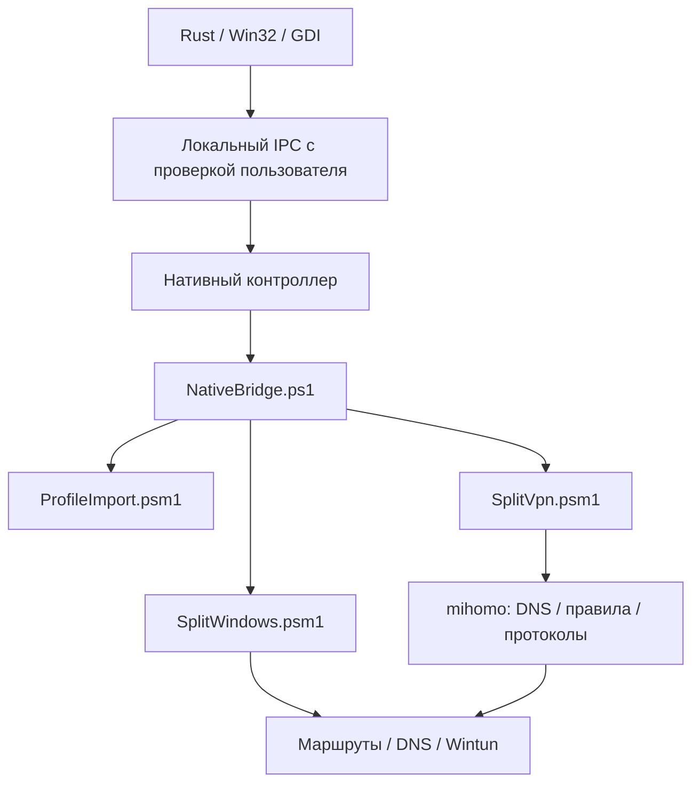

# Архитектура

Приложение сохраняет небольшое разделение: нативный интерфейс, контроллер жизненного цикла, операции Windows и отдельное сетевое ядро. Браузерного движка, WebView и постоянно работающего Node.js нет.

| Место | Ответственность |
| --- | --- |
| `native/src/ui.rs`, `i18n.rs` | Окно, формы, трей и языки |
| `native/src/backend.rs`, `service.rs`, `platform.rs` | IPC, владение процессами, состояние, отмена и дедлайны |
| `native/src/setup.rs`, `Install.ps1`, `Uninstall.ps1` | Установка, обновление, права и удаление |
| `NativeBridge.ps1` | Выполнение ограниченной операции и ответ JSON |
| `ProfileImport.psm1` | Ограниченный локальный парсер и нормализация узлов |
| `SplitVpn.psm1` | Валидация настроек, генерация конфига и обращения к API ядра |
| `SplitWindows.psm1` | Выбор физического транспорта, контроль маршрутов, DNS и восстановление |
| `native/build.rs`, `font.rs`, `texture.rs`, `design.rs` | Встроенные ресурсы, шрифт, анимация и буферная отрисовка |
| `appearance.rs`, `appearance_ui.rs`, `mushroom.rs`, `hero.rs` | 20 палитр, размеры интерфейса, галерея, общая пиксельная графика и состояния кнопки |
| `profile_store.rs`, `autostart.rs`, `AppStartup.ps1` | Атомарные операции с индексом профилей и регистрация запуска с Windows |
| `presets.rs`, `preset_ui.rs`, `RulePresets.ps1` | Наборы, редактор, переносимые JSON и общий черновик |
| `TrafficGuard.psm1`, `traffic_guard*.rs`, `cleanup_request.rs`, `setup_recovery.rs` | Экспериментальная WFP-защита, отмена и восстановление проверенной службы |

## Жизненный цикл и импорт

Интерфейс и контроллер ждут событий. PowerShell работает на время операции. Запуск, отмена, отключение и выход синхронизируются; новая отмена/выход имеют приоритет над устаревшей операцией. Ответ bridge заканчивается переводом строки: нельзя ждать EOF stdout, если ядро остаётся дочерним процессом. Подробности и регрессии: [native/README.md](https://github.com/0nionow1/Mukhomor/blob/main/native/README.md).

Импорт не управляет глобальными настройками ядра и не выполняет скрипты профиля. Сначала проверяются весь ввод и кандидат конфигурации через закреплённый mihomo, затем обновляется библиотека. Профили и API-токен хранятся как приватные локальные данные. Выбранный сервер имеет исторический внутренний псевдоним `AWG` для всех протоколов; это не ограничение только WireGuard.

## Правила и производительность

Настройки schema=2 содержат обычные правила в `direct` и единую коллекцию `presets`. `RulePresets.ps1` выполняет миграцию schema=1, проверяет структуру и строит отдельную runtime-проекцию. Сохранённые строки и владельцы не заменяются нормализованной проекцией. `enabled` и `disabled_sections` влияют на работу правил; `visible_sections` — только на интерфейс. Rust-модуль `presets.rs` обеспечивает ту же миграцию для раннего snapshot и операции редактора; `preset_ui.rs` объединяет управление на обоих экранах.

Сохранённая модель ограничена 2 МиБ компактного UTF-8 JSON с экранированием Windows PowerShell 5.1. Ответ IPC допускает 4 МиБ; диагностике выделено не более 512 КиБ и 200 замечаний, отдельно передаётся полное количество. Это оставляет место для настроек и библиотеки из 512 серверов даже при больших ошибочных строках. Предупреждения открываются в прокручиваемом редакторе только для чтения; открытие, копирование и закрытие не меняют черновик.

`ValidateSettings` возвращает предупреждения без записи или перезагрузки ядра. `ApplySettings` сохраняет исходные записи, проверяя скомпилированный конфиг закреплённым ядром. Диагностика содержит владельца, секцию и номер строки; IPC ограничивает подробности первыми 200 предупреждениями и отдельно возвращает общее количество. Фоновые snapshots сохраняют диагностику только для тех же настроек. Конфигурация ядра, DNS refresh и обновление источников используют одну проекцию, а API probes читают только schema и controller port.

Большие списки от 32 пользовательских доменов или IP/CIDR компилируются в нативные наборы mihomo. Приоритеты и точное/суффиксное совпадение сохраняются; наборы входят в валидируемый кандидат и откатываются вместе с ним. Поиск процессов отключён, когда EXE-исключений нет. Порядок правил описан в [руководстве для пользователей](gaming-and-routing.md).

Палитра в `assets/theme.json` компилируется в EXE. Фон использует сплошные пиксели размером 13 логических единиц без сетки. При сборке создаются статическое поле и 24 ключевых кадра плавного 48-секундного цикла. Во время работы клиент смешивает цвета только видимых ячеек и копирует строки в один повторно используемый GDI bitmap; шум и тригонометрия во время анимации не рассчитываются. Фон обновляется с частотой до 20 кадров в секунду, поля ввода и непрозрачные списки остаются вне этого цикла. Кадр готовится до перерисовки дочерних элементов. `WS_EX_COMPOSITED` объединяет вывод окна и элементов, а смещение прокрутки сбрасывается перед копированием буфера на экран. Таймеры останавливаются в трее и при сворачивании; анимация фона управляется собственным переключателем независимо от системной анимации элементов Windows.

`design.rs` задаёт три ступеньки углов с шагом четыре пикселя при масштабе 100% и кэширует регионы панелей. В **Настройки → Дизайн** можно отдельно отключить анимацию и скругления либо все визуальные улучшения сразу. Сетка удалена, её старое сохранённое значение игнорируется. Общий выключатель возвращает однотонные поверхности и освобождает bitmap анимации. Эти пользовательские предпочтения сохраняются атомарно рядом с языком в `ui-preferences.json` и не изменяют настройки VPN. Палитры доступны пользователю в **Настройки → Оформление**: 20 тем и размеры 85/100/125%, применяемые без перезапуска. По умолчанию используется Неон; исходная палитра Classic доступна как Классика.

## Изоляция и публикация

У Mukhomor собственные IPC, TUN-адаптер, порты и правила Windows. Настройки других VPN не импортируются автоматически. Перед подключением выполняется проверка другого VPN. Установка и DNS действительно затрагивают Windows; большинство тестов подменяют эти операции или используют loopback.

Git публикует только разрешённые исходники. Релиз собирается по явным спискам файлов, с проверкой SHA256 зависимостей и манифестом каждого пакета. Приватные конфиги не являются входом сборки. Новую документацию и тесты нужно включать в список упаковки; [инструкция выпуска](releasing.md) описывает проверку.

Помощник запускается с `-NonInteractive`, читает и записывает JSON как UTF-8 непосредственно через стандартные байтовые потоки ([Console.OpenStandardInput](https://learn.microsoft.com/en-us/dotnet/api/system.console.openstandardinput?view=netframework-4.8.1)). Кодировка обмена не зависит от текстовых настроек оболочки PowerShell.
