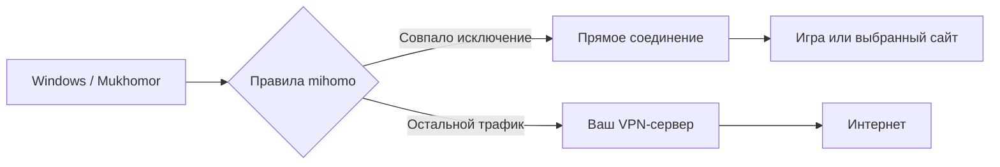

# Игры и исключения

## Зачем это нужно

Если игра идёт через удалённый VPN-сервер, меняется её сетевой маршрут. Mukhomor позволяет отправить её напрямую, а браузер и остальной трафик оставить в VPN. Это убирает VPN из игрового пути; результат зависит от провайдера, игрового сервера и маршрута. Приложение не обещает уменьшить пинг ниже обычного прямого соединения.

## Пресеты в версии 0.7.2

На странице «Наборы» введите имя и нажмите «Создать» либо выберите «+ Готовый». Галочка слева от имени включает и отключает весь набор. Здесь же доступны «Удалить», «Импорт» и «Экспорт». «Правила» открывает выбранный набор на отдельной странице: выберите один из шести типов, добавьте строку через поле «Новое правило» и кнопку «Добавить» или выделите строку и нажмите «Убрать». В редактор также можно вставить несколько строк. «Параметры» открывают имя, описание, переключатель текущего списка и источники доменов. «Сохранить» применяет общий черновик всех наборов.

Все шесть списков набора доступны сразу, включая пустые. Переключатель «Список включён» в параметрах управляет ручными правилами выбранного типа. Галочка набора на странице «Наборы» управляет всеми его правилами и подключёнными источниками. Обновляемые списки доменов не зависят от переключателя ручного списка. «Мои правила» хранятся отдельно и сохраняются при удалении набора.

Готовые наборы Games, Torrent clients, Russian services, Steam и Ozon можно переименовывать, изменять и удалять. Torrent clients сохраняет прежнюю идентичность пресета qBittorrent. Ozon изначально выключен, поскольку его домены уже входят в Russian services. «Восстановить правила» возвращает исходные правила и источники выбранного готового набора, сохраняя имя, описание и переключатели. Удалённый готовый набор можно снова добавить через «+ Готовый», не затрагивая остальные правила. Общий «Сбросить правила и пресеты» в настройках возвращает базовые наборы и очищает «Мои правила»; серверы и настройки подключения сохраняются.

«Экспорт» сохраняет отдельный JSON-файл набора без серверов и настроек подключения. «Импорт» добавляет его как новый выключенный набор: существующие наборы не заменяются. После просмотра правил включите его галочкой и сохраните изменения.

Обновление настроек версии 0.5.x переносит существующие игровые процессы в Games, qBittorrent — отдельно, а готовые источники и зоны — в соответствующие пресеты. Удалённые пользователем правила не возвращаются при миграции. Удалённые пресеты не появляются снова при обычном запуске.

«Проверить» показывает пресет, раздел и строку с проблемой. Некорректные записи сохраняются для исправления; в конфигурацию ядра входят только корректные правила. Проверка также сообщает о повторениях, затенённых исключениях через VPN и доменах DNS-кэша, которые не соответствуют включённым правилам. Она не меняет пользовательские переключатели. При большом количестве проблем интерфейс показывает первые записи и общее количество.

Трафик исключений выходит через вашего провайдера и показывает обычный внешний IP. Исключения — сознательный выбор маршрута. Публичные списки и `.ru`/`.рф` включены по умолчанию; это приложение не предназначено для режима «абсолютно всё только через VPN».

## Что настроено заранее

В [публичных настройках](../assets/settings.default.json) расширены все пять базовых пресетов. Снимок доменных списков от 13 октября 2026 года поставляется в архиве; количество правил и SHA-256 каждого начального списка записаны в [sources.json](../lists/sources.json).

| Пресет | Правила из коробки |
| --- | --- |
| Games | 286 имён процессов игр, серверов и лаунчеров; 1 123 доменных правила игровых платформ и CDN |
| Torrent clients | 17 процессов: qBittorrent, Transmission, Deluge, µTorrent, BitTorrent, Tixati, BiglyBT, Vuze, PicoTorrent и другие |
| Russian services | 1 122 начальных доменных правила и 63 явных суффикса российских сервисов, CDN и доменных зон |
| Steam | 5 процессов клиента и SteamCMD, 15 явных доменных суффиксов, 60 правил в обновляемом списке Valve |
| Ozon | 46 явных суффиксов, включая Банк, Travel, зарубежные витрины и CDN, плюс 63 правила в обновляемом списке; пресет выключен по умолчанию |

Игровые процессы покрывают шутеры, MMO, кооператив, стратегии, гонки и выделенные серверы: CS2, Dota 2, Deadlock, PUBG, Valorant, Apex Legends, Fortnite, Escape from Tarkov и Arena, War Thunder, World of Tanks/Warships, Warframe, WoW, Final Fantasy XIV, Albion, EVE, Guild Wars, GTA, Rainbow Six, Battlefield, Call of Duty, Minecraft Bedrock, ARK, DayZ, Rust, Valheim, Terraria, Path of Exile, Diablo, Monster Hunter и другие. Включены Epic Games, Battle.net, EA, Riot, Ubisoft и HoYoPlay. Количество процессов учитывает лаунчеры, серверы и варианты запуска, а не число отдельных игр. Правила процессов действуют на TCP и UDP.

Российский пресет покрывает `.ru`, `.рф`, `.su`, `.moscow`, `.москва`, `.рус`, `.дети`, `.tatar` и `.yandex`. Международные домены Яндекса, VK, ОК, Сбера, Ozon, Wildberries, 2ГИС, видеосервисов и облаков также идут напрямую. Банки и госуслуги в российских зонах покрываются суффиксом целиком. Явные сервисные суффиксы работают независимо от доступности обновляемого списка.

Включены доменные источники **Игровые сервисы**, **Россия** и **Steam** из [meta-rules-dat](https://github.com/MetaCubeX/meta-rules-dat). Игровой источник содержит Steam; чтобы вернуть домены Steam в VPN, отключите также игровой источник и явные правила Steam либо добавьте подходящие исключения с учётом приоритетов ниже. Доменные правила платформ затрагивают авторизацию, магазин, загрузки и CDN, а не только игровые матчи. Суффикс `in.th` из общего игрового источника исключён: это публичная зона регистрации, поэтому сам по себе он не означает игровой сервис.

Существующая установка сохраняет отредактированные пресеты. Новые базовые правила доступны после обновления приложения через «Восстановить правила» для выбранного базового пресета или «Сбросить правила и пресеты» для всех. Восстановление правил сохраняет переключатели разделов; убедитесь, что нужные разделы и пресет включены.

## Добавить игру

1. Откройте **Исключения**.
2. Добавьте имя процесса, например `my-game.exe`, или выберите полный путь к `.exe`.
3. Нажмите **Сохранить**.
4. Перезапустите игру или переподключите её к серверу: уже открытые соединения могут сохранять прежний маршрут.

Имя лаунчера не обязательно совпадает с процессом игры. Проверьте вкладку **Подробности** Диспетчера задач. Правило по имени применяется к любому процессу с таким именем; полный путь точнее.

Для Minecraft Java, Java-серверов и игр с общим именем `launcher.exe`, `game.exe` или `Client-Win64-Shipping.exe` добавьте полный путь к нужному исполняемому файлу. Общие `java.exe`, `javaw.exe`, `python.exe`, `node.exe` и системные процессы не исключены по имени: они используются другими приложениями. Доменный игровой список помогает с известными сервисами, но не охватывает любой частный сервер по IP; такой сервер требует исключения процесса, пути или своего адреса.

## Домены и IP

Каждая строка — отдельное правило.

| Список в интерфейсе | Пример | Действие |
| --- | --- | --- |
| Точные домены | `example.com` | Только этот домен |
| Домены с поддоменами / зоны | `example.com` | Домен и его поддомены |
| Зоны | `ru`, `рф` | Вся соответствующая зона |
| IP и CIDR | `192.0.2.10`, `2001:db8::/32` | Соответствующие адреса; здесь приведены учебные адреса |
| Исключения из готовых списков | `example.com` | Возвращает домен и поддомены в VPN, если их направлял напрямую готовый список |

Для игровых процессов удобнее `.exe`: адреса серверов могут меняться. IP-правило для общего CDN может затронуть несколько сервисов; по возможности используйте домен.

## Приоритеты

Первое совпавшее правило определяет маршрут:

1. Адрес самого VPN-сервера идёт напрямую, чтобы соединение не завернулось в собственный туннель.
2. Ваши исключения процессов.
3. Ваши точные домены и суффиксы/зоны.
4. Домены, возвращённые в VPN из публичных списков.
5. Включённые публичные списки.
6. Локальные сети, затем ваши IP/CIDR.
7. Известный прочий домен идёт в VPN; необязательный DNS-IP резерв применяется к соединениям без известного домена.
8. Остальной трафик — выбранный VPN-профиль.

Поэтому «вернуть в VPN из готового списка» не отменяет более раннее исключение процесса или вашу зону `ru`. Уберите соответствующее более раннее правило, если хотите такой домен направить в VPN.

## qBittorrent и голосовая связь

Для включённых процессов из Torrent clients используется обычный сетевой интерфейс. Если в самом qBittorrent задан только VPN-адаптер, эта привязка может мешать прямому маршруту. Проверьте **Настройки qBittorrent → Дополнительно → Сетевой интерфейс**. Название пресета не ограничивает его действие одним qBittorrent; ненужные процессы можно удалить или отключить весь пресет.

Mukhomor не отправляет весь UDP напрямую. Звонки и другие программы используют VPN, если для них нет исключения и выбранный протокол поддерживает их транспорт.

## DNS и списки

Публичные начальные списки поставляются с архивом; включённые списки обновляются ядром с интервалом 6 часов. В **Настройки → Настройки DNS** можно включить дополнительное получение A/AAAA через Cloudflare и Google DNS JSON API. По умолчанию оно выключено.

Эта опция учитывает TTL, CNAME, ограничения количества адресов и сохраняет последний успешный ответ на ограниченное время. Наблюдение добавляет реально встреченные поддомены, а не перечисляет все поддомены сайта. Резервные IP не превращают известные чужие домены на общем CDN в прямые исключения.

## Полный режим VPN (экспериментальный)

По умолчанию используется разделение трафика. В полном режиме сохранённые исключения процессов, доменов и IP не применяются: трафик направляется в выбранный VPN, а LAN допускается только отдельным параметром. Для смены режима и доступа к LAN нужно отключиться; редактирование исключений не делает их действующими в полном режиме.

WFP-защита и восстановление после аварии включены как экспериментальные возможности. Статус защищённого соединения требует проверенных фильтров и работающего собственного туннеля. Реальная квалификация WFP/SCM, утечек и перезагрузки в Windows VM ещё не завершена. Синтетические проверки конфигурации и loopback не подтверждают полноценный kill switch.
